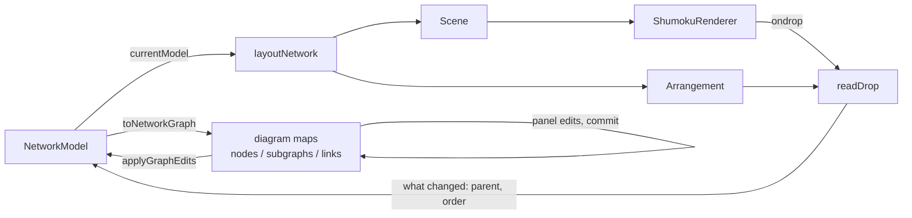

# Architecture

Cross-cutting overview of how the shumoku monorepo fits together.
Editor-specific data model details live in
[`apps/editor/docs/design/data-model.md`](../apps/editor/docs/design/data-model.md);
link composition (port / plug / module / cable) is in
[`apps/editor/docs/design/connection-model.md`](../apps/editor/docs/design/connection-model.md);
this doc focuses on the flows that span packages.

How the input network model is being redesigned is in
[`network-model.ja.md`](network-model.ja.md).

## Contents

- [Bird's-eye view](#birds-eye-view)
- [Drawing (core + renderer)](#drawing-core--renderer)
- [Editor state and edits](#editor-state-and-edits)
- [Server](#server)
- [Package boundaries](#package-boundaries)
  - [Plugin contract](#plugin-contract)
- [Camera (pan/zoom)](#camera-panzoom)
- [Known gaps](#known-gaps)

---

## Bird's-eye view

```mermaid
flowchart LR
  subgraph IN[Inputs]
    YT[YAML text]
    ZIP[.neted.zip project]
    UI[Panels and canvas edits]
    SRC[Server: resolved sources]
  end

  subgraph CORE[@shumoku/core]
    NM[NetworkModel<br/>config + drawing]
    DN[drawNetwork<br/>structure, ranks, order,<br/>routes, coordinates]
    SC[Scene<br/>boxes, wires, ports, hulls]
  end

  subgraph RNDR[@shumoku/renderer]
    KIT[kit: Diagram<br/>one SVG component]
    SR[ShumokuRenderer<br/>selection, drop, overlays]
    ST[static: renderScene]
  end

  YT -->|readNetworkModel| NM
  ZIP --> NM
  SRC -->|resolveNetwork → model + observation| NM
  UI -->|applyGraphEdits| NM
  NM --> DN --> SC
  SC --> KIT
  KIT --> SR
  KIT --> ST
```

**Reading guide:**

- The `NetworkModel` is the truth. The Scene is only its projection, made
  fresh by `drawNetwork` each time; **no position is ever stored** (the
  old engine kept `position` / `bounds` / ports / edges as state; they are
  gone).
- Everything discrete (ranks, left-right order, corridors, routes, counts)
  is decided from relations before any coordinate; coordinates are solved
  once per axis at the end (`libs/@shumoku/core/src/drawing/`).
- The kit (`@shumoku/renderer/src/kit`) draws a Scene. The interactive
  `ShumokuRenderer`, the server's static output (`renderScene`), the CLI,
  PNG and HTML exports all draw with that one component, so they cannot
  differ.

---

## Drawing (core + renderer)

```text
NetworkModel ─ layoutNetwork(model, { metrics }) ─► Drawing { scene, arrangement }
                 deriveStages(config, { boundary })     scene: boxes / groups / wires / ports / hulls
                 layoutParts(config, structure, metrics, { layers, hints: { siblings: drawing.order } })
                                                        arrangement: frames, rows, order by id

configuration → structure → relative placement (frames, rows, order) + a person's intent → coordinates
```

- `metrics` is a function, `(model) => Metrics`: the lengths the drawing
  works with. They come from the renderer's kit (`drawingMetrics(kit, model)`),
  derived from a few bases (text size, stroke), never from hardcoded px.
  `drawNetworkScene(model)` in `@shumoku/renderer` supplies the kit's metrics
  and is the one-call form to use.
- `boundary` (where the network meets what lies beyond it, which up and down
  are measured from) is decided by `boundaryOf` (`drawing/draw.ts`), in this
  order; an earlier step wins:
  1. `drawing.settings.boundary`. No YAML field or UI sets it today; only code that
     builds the `NetworkModel` can.
  2. The structure's candidates: nodes that have both a cable and a virtual
     link (`structure/orientation.ts`).
  3. Nodes of type `external` or `cloud`, and the routing domains that links
     reach. `type: internet` is not among them.
  4. For each connected part of the network that none of 1-3 reaches, a
     guessed upstream (`drawing/upstream.ts`): by node type (router /
     firewall / vpn / cpe, then l3-switch / load-balancer, then l2-switch,
     then access-point), else the node(s) ending the fastest link, else the
     graph centre. This applies per part, also when other parts have a
     boundary. A lone node gets nothing.
- The **arrangement** (`drawing/arrangement.ts`) is the relative placement the
  stages settled on, named so a person's intent has something to speak about:
  for each frame (group id; `ROOT_FRAME`, `''`, for the top level) its children
  left to right, each with the rows it holds, by the ids the configuration uses
  (a node, a redundancy set with its members, a segment, a routing domain, a
  group). It decides nothing and holds no coordinate.
- A person's intent is `drawing.order`: by frame, a sparse list of ids whose
  relative order was chosen. `layoutNetwork` reads it from the model itself, so
  the editor and the server bake (`apps/server/api/src/services/derive.ts`)
  draw one model the same way. The engine holds the named children in that
  order and places the rest; a name the drawing has no child for is ignored
  (and kept, so it returns with what it names); one the structure places
  otherwise, such as a free item or a child of another frame, is reported in
  `Arrangement.unmet`. Structure wins over intent, intent over crossing
  reduction.

Sheets (one page per group, with `file` / `pins`) were dropped: nested groups
are drawn on one page. Revisit as a view (a sub-scene cut out of a group)
when large networks need it.

---

## Editor state and edits

The editor keeps the project's `NetworkModel` (`model` in
`apps/editor/src/lib/context.svelte.ts`) and, beside it, the graph drawn
from it in `SvelteMap`s (`diagram.nodes`, `diagram.subgraphs`, a link
array). The panels edit that graph in place. It holds **no layout**: no
positions, ports or routed edges.



- A **commit** snapshots the model for undo, runs the edit, and writes what
  changed on the graph back into the model (`applyGraphEdits`), so
  YAML-only fields survive. Undo and redo replace the model and draw the
  graph again.
- The diagram page draws `currentModel()` (the model with the edits so far
  applied) through `drawNetworkScene` after a short pause, and hands the
  Scene to `ShumokuRenderer`.
- **Drag** (edit mode): `ShumokuRenderer` reports where a node or group was
  dropped (`ondrop`). `readDrop` (`state/order-hints.ts`) reads it against the
  last solved `Arrangement` and the scene's boxes, the one place a pointer
  becomes a place in the drawing: the frame the element's centre landed in,
  the row of that frame nearest to it, and the two children of that row it
  fell between. It returns only what changed: the group (`config.group`, a
  configuration edit, made through the graph) and the order of the new frame
  (`drawing.order`, merged into the frame's existing list with the moved id
  and its two neighbours, by the engine's own frame order, never by x). A drop
  in the original slot returns nothing and leaves no undo step; a free item or
  a node beside its host takes no order. Coordinates are never stored.
  "Auto-arrange" drops every order. The status badge counts the hints the
  structure overrode (`Arrangement.unmet`).
- Load: every input ends in `loadProject`, which resets state once and
  applies the project (`applyProject`: sanitize, product fix-ups, legacy
  scene migrations), then writes the result back into the model.
- The floor-plan Scene mode (`routes/project/[id]/scene`, the editor's own
  `Scene` type) is separate from the drawing's `Scene`: it places nodes by
  coordinates on a plan and is unchanged. Its scope is the `?focus=` group.

---

## Server

The bake (`apps/server/api/src/services/derive.ts`, run in a worker by
`derive-worker.ts`) resolves the sources into a model, draws it with
`drawNetworkScene`, and stores `{ scene }`; `RESOLVER_VERSION` must be bumped
when the resolve or drawing algorithm changes. `resolveNetwork` carries the
project's `drawing.order` into the merged model, and the engine reads it, so
the server's picture of a model is the editor's. The mapping (metrics bindings, bandwidth
overrides) is not part of the baked artifact: it is read on every request and
put on the graph's and the scene's links when served.

---

## Package boundaries

What each package owns, and what it doesn't:

```mermaid
flowchart TB
  subgraph apps[apps/]
    ED[editor<br/>SvelteKit UI, state, routes]
    DOC[docs<br/>Astro]
    CLI[cli<br/>shumoku render]
    SRV[server<br/>topology API]
  end

  subgraph libs[libs/@shumoku/]
    COR[core<br/>models, layout, parser]
    CAT[catalog<br/>device/service catalog]
    SDK[plugin-sdk<br/>HTTP client, pagination]
    RND[renderer<br/>Svelte + static SVG]
    RSV[renderer-svg<br/>compatibility SVG]
    RHT[renderer-html<br/>embeddable]
    RPN[renderer-png<br/>resvg]
    SHU[shumoku<br/>umbrella]
  end

  subgraph libp[libs/plugins/]
    PAI[aruba-instant-on]
    PGF[grafana]
    PNB[netbox]
    PNS[network-scan]
    PPR[prometheus]
    PZB[zabbix]
  end

  ED --> COR
  ED --> CAT
  ED --> RND
  ED --> RSV

  CLI --> COR
  CLI --> RND
  CLI --> RPN
  CLI --> RHT

  SRV --> COR
  SRV --> RHT
  SRV --> RND
  SRV --> CAT
  SRV --> RPN

  CAT --> COR
  RND --> COR
  RSV --> COR
  RSV --> RND
  RHT --> RSV
  RHT --> RND
  RPN --> RND
  RPN --> RSV
  SHU --> COR
  SHU --> RSV
  SHU --> RHT

  PAI --> COR
  PGF --> COR
  PNB --> COR
  PNB --> SDK
  PNS --> COR
  PNS --> CAT
  PPR --> COR
  PZB --> COR
  PZB --> SDK
```

**Invariants:**

- **Plugins depend only on `core`** (plus the shared `plugin-sdk`
  runtime helpers, and `catalog` where device identification needs
  it) — never on renderers, never on editor. Keeps them embeddable
  anywhere.
- **Renderers depend on `core`** — never on editor. Core models are
  the lingua franca.
- **Editor depends on core + catalog + renderer** — its `renderer-svg`
  export facade delegates to the static renderer.
- **Server consumes renderers, not just core** — the bake draws a `Scene`
  (`drawNetwork`), exports render it with the kit, and the web UI shows it
  with `ShumokuRenderer`.
- **CLI SVG, PNG, and standalone HTML share one drawing** — `drawNetwork`
  makes the scene, `@shumoku/renderer/static` renders it with the kit, and
  `renderer-html` adds the tooltip and pan/zoom runtime shell around the
  same SVG.
- **Apps don't cross-depend** — editor doesn't import from docs, etc.

The **canonical data shape** is `NetworkModel`: `config`, the configuration
data in the YAML's shape (nodes with their ports and library products, links
with their plugs, cable and `via`, groups, segments, terminations), and
`drawing`, how it is drawn (looks, icons, `order`). Nothing else rides in it:
coordinates are the Scene's (the drawing engine's, or the Editor's floor-plan
scenes), and how nodes are recognized across sources is the merge's input and
record (`SourceNetwork.observation` in, `ObservationLayer` out of
`resolveNetwork`), kept beside the model by the Server and joined into the
graph with `toNetworkGraph(model, observation)`. Every source, the project's own
configuration included, is a `SourceNetwork` of the same shape; the merge
orders them, nothing more. `NetworkGraph` is a display projection
(`toNetworkGraph`) that the panels edit and the drawing reads its nodes and
links from; it is not an input format.

### Plugin contract

Data-source plugins (Zabbix, NetBox, Prometheus, Grafana, Aruba
Instant On, network-scan) connect shumoku to external systems through a small
contract in `@shumoku/core`. The rule is **core defines the display
contract; plugins conform**. Concretely:

- Core types describe what the UI consumes — `Host`, `Alert`,
  `LinkMetrics`, etc. — and contain no plugin-name enums.
- Plugins translate upstream vocabularies (Zabbix priorities,
  Prometheus severities, Aruba health tokens) into core vocab at
  their own boundary — never the other way.
- The web app renders plugins generically via `configSchema`; it
  must not branch on `plugin.type`. (#270 is resolved — the
  invariant is now enforced by a vitest guard,
  `apps/server/api/src/plugins/host-branch-guard.test.ts`, which
  fails the build if a `type === '<plugin>'` branch reappears in
  the config surfaces.)

For the full author-facing reference — capability mixins, data
shapes, severity translation table, the three node-state axes, the
passthrough `discoverMetrics` pattern, dev-only `nativeApi` — see
[`plugin-authoring.md`](./plugin-authoring.md).

---

## Camera (pan/zoom)

Camera behaviour — how wheel events, trackpad gestures, pinch and
pointer drags translate into viewport transforms — is deliberately
**not** baked into `@shumoku/renderer`. Different apps want different
policies (the editor wants mouse-wheel-zoom like a CAD tool; a static
share preview wants no camera at all; SSR/CLI has no DOM to attach
to), and a renderer that picks a default for everyone ends up either
wrong-by-default or stuffed with opt-out props.

```mermaid
flowchart LR
  subgraph RND[@shumoku/renderer]
    SVG[SVG output<br/>stable DOM:<br/>g.viewport, g.node[data-id], path.link]
    AC[attachCamera<br/>utility<br/>opt-in]
  end

  subgraph WG[wheel-gestures]
    START[isStart marker]
    MOM[isMomentum marker]
  end

  subgraph D3[d3-zoom]
    ST[__zoom state]
    TRF[transform on g.viewport]
  end

  subgraph APP[Host app]
    EDT[editor]
    WID[dashboard widget]
    DET[detail page]
    SHR[share page]
  end

  SVG -.- AC
  AC --> WG
  AC --> D3
  D3 --> TRF
  WG --> AC

  EDT --> AC
  WID --> AC
  DET --> AC
  SHR --> AC
```

### API shape

```ts
import { attachCamera } from '@shumoku/renderer'

const camera = attachCamera(svgEl, {
  scaleExtent: [0.2, 10],           // zoom bounds
  panFilter: (e) => e.altKey,       // which pointer-down events pan
  wheelZoomSensitivity: 1.0015,     // mouse tick feel
  pinchZoomSensitivity: 1.01,       // trackpad pinch feel
})
camera.zoomBy(1.5)
camera.panToNode('device-42')
camera.reset()
camera.detach()                     // cleanup on unmount
```

The renderer always emits a `<g class="viewport">` as its zoom target;
`attachCamera` throws if that element isn't present. Apps that want
**no** camera simply don't call `attachCamera`.

### UX policy (Figma / Miro style)

| Input | Result |
|---|---|
| Mouse wheel (plain) | zoom at cursor |
| Mouse ctrl+wheel | zoom at cursor (explicit) |
| Trackpad two-finger | pan (with natural momentum) |
| Trackpad pinch | zoom at cursor (browser synthesises `ctrlKey=true`) |
| Middle-click drag / Alt+left-drag | pan (via `panFilter`) |
| Node / group drag (edit mode) | reported as a drop; becomes order hints (handled in `ShumokuRenderer`) |

### Why we need three layers (d3-zoom + wheel-gestures + sticky detection)

Each layer solves a problem the others can't:

1. **d3-zoom** owns the transform state (`svg.__zoom`). It's a stable
   base: attaching to the svg once and routing all transform changes
   through `zoomBehavior` keeps state consistent regardless of whether
   a change came from a wheel event, imperative `zoomBy`, or external
   `panToNode` call. A previous version bypassed d3-zoom by writing
   `transform=` directly on the viewport — d3-zoom's state went stale
   and the next gesture jumped to wherever d3-zoom last remembered.

2. **wheel-gestures** classifies each event as "user input", "momentum
   tail", or "gesture start". We use two specific signals:
   - `state.isStart` — the first event of a gesture. That's when we
     decide "mouse or trackpad" and stick with the verdict. Per-event
     classification doesn't work because Chrome's smooth-scrolling
     makes mouse wheel ticks indistinguishable from trackpad scrolls
     frame-by-frame (both can emit fractional deltaY with varying
     magnitudes).
   - `state.isMomentum` — OS-generated inertia events that continue
     after the user's fingers have lifted. Critically, these often
     drop `ctrlKey` partway through a pinch's decay. Skipping momentum
     for zoom prevents phantom pans after a pinch; keeping it for
     pan preserves the natural trackpad feel.

3. **Sticky device detection** (inside `attachCamera`) runs at
   `isStart` only, using `deltaMode`, presence of `deltaX`, and
   magnitude of `deltaY` as signals. Once picked — `mouse` or
   `trackpad` — the whole gesture uses that mode, so mid-flight
   event ambiguity can't flip the verdict.

### Coordinate-system discipline

The renderer's SVG uses a `viewBox` sized to the layout bounds with
`width="100%"` — so one viewBox user-space unit is NOT one CSS pixel.
d3-zoom's transform is applied as an SVG `transform=` attribute on
the viewport group, which is interpreted in user-space. The wheel
event's `clientX/Y` is in screen pixels. Passing the cursor to
d3-zoom directly drifts the zoom focus by the viewBox scale factor.

`attachCamera` converts cursor to user-space via
`svg.getScreenCTM().inverse()` and declares `zoom.extent` in user-space
too, so d3-zoom's internal math and the applied transform agree.

### Consumer summary

- **editor** — `attachCamera(svg)` with defaults (Miro/Figma UX).
- **docs/editor** — same, attached after the WebComponent's
  `customElements.whenDefined('shumoku-renderer')` resolves.
- **server/web TopologyViewer** — takes `camera?: CameraOptions | false`
  as a prop; passes through to `attachCamera`. Widget, detail page
  and share page all use this.
- **CLI / PNG / SSR** — don't mount a Svelte component, so never see
  `attachCamera`. d3-zoom isn't loaded at all in those paths.

---

## Known gaps

### Hierarchical / multi-sheet editing

Sheets are removed: the drawing engine has no sheet or pin concept, so
nested groups are drawn together on one page and the viewer, the HTML export,
the server and the editor no longer navigate between sheets. Revisit as a view (a
sub-scene cut out of a group) when large networks need it.

### Row intent

A drag records the frame and the order within a row; a drop in another row of
the same frame is read as an order against that row's neighbours, and the row
itself stays the structure's. An intent about rows ("below Y", "level with Y")
is not stored yet. If it is added, it should be relative to other ids, solved
once without it and turned into a `Hints.rank` floor, never an absolute rank
number (see `apps/editor/docs/design/arrangement.md`).
