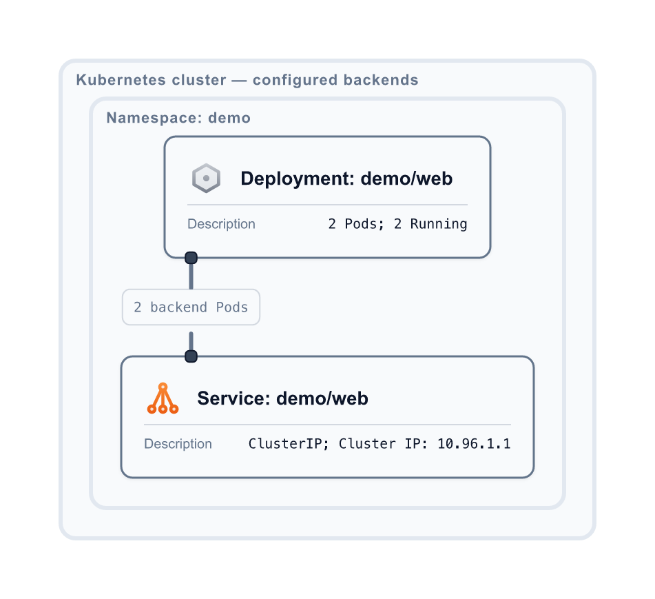
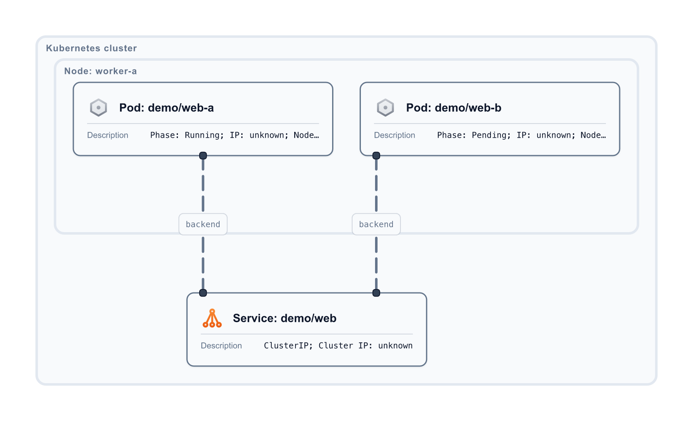
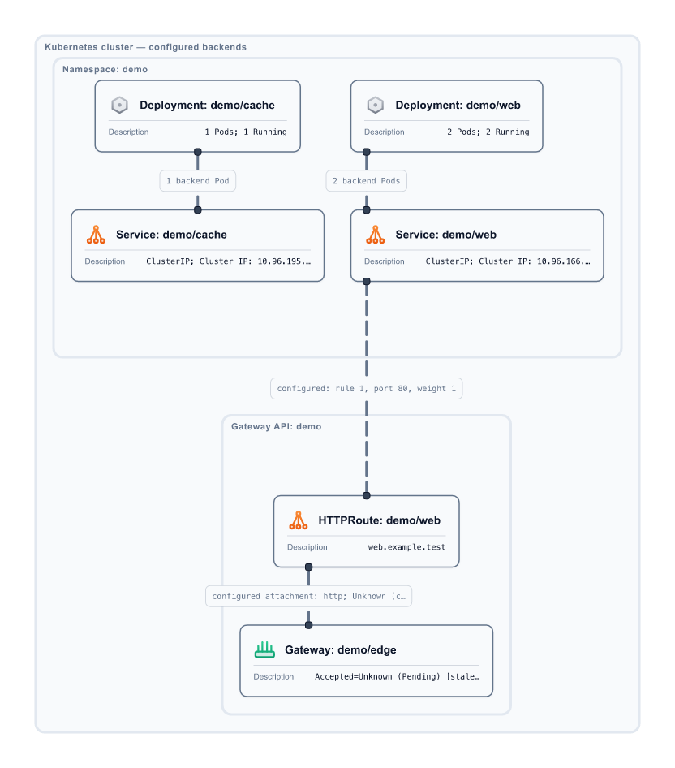
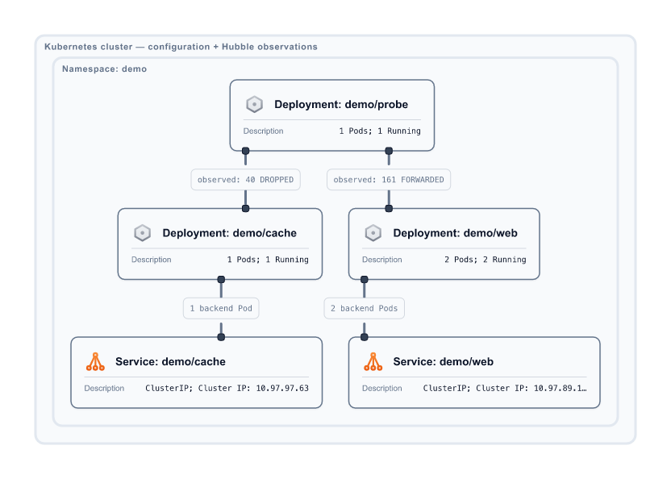

# Kubernetes topology

The bundled `kubernetes` data source reads the API of the cluster where Shumoku
runs. Its default **Services and workloads** map groups Pods by their observed
controller ownership: ReplicaSet → Deployment and Job → CronJob, plus StatefulSet,
DaemonSet, standalone ReplicaSet/Job and standalone Pods. It does not infer owners
from names or labels. Stale or unavailable owners do not cause unrelated Pods to merge.
Rollout ReplicaSets remain one Deployment; scaled-to-zero workloads remain visible.

The map groups resources by namespace inside a Kubernetes cluster frame. Each
Service-to-workload line states how many backend Pods were found in EndpointSlices.
Click a workload to see its Pods, phase, Node placement, IPs and related Services;
click a Service to see its actual backend Pods and endpoint conditions. The generic
node details view is available to viewers too; monitoring configuration stays restricted.

Select **Pods and Node placement** for individual Pod cards inside Node frames,
with Service links reaching those cards directly. This view does not read workload APIs.
An unobserved Node or unscheduled Pod stays at cluster level.

Both views show **configured backends**, not observed communication, NetworkPolicy
reachability, traffic volume, latency or drops. No traffic metrics are fabricated.

## Run in the cluster

Use a Shumoku release containing this plugin (it is not included in 0.2.0).
Helm can create the ServiceAccount bindings and enable token mounting. RBAC is
**disabled by default**. For a single namespace, use:

```yaml
kubernetesDiscovery:
  enabled: true
  namespaces: [demo]
  includeNodes: false
```

This creates a Role and RoleBinding in `demo`, with **list only** for Pods,
Services, EndpointSlices and workload controllers. An empty `namespaces` list defaults to the Helm
release namespace; it never means all namespaces in scoped mode. Target
namespaces must already exist. The Helm installer needs permission to create
these Roles and RoleBindings there.

To show the whole cluster, including Node placement:

```yaml
kubernetesDiscovery:
  enabled: true
  clusterWide: true
  includeNodes: true
```

This creates a ClusterRole and ClusterRoleBinding with **list only** for Nodes,
Pods, Services, EndpointSlices and workload controllers. No Secrets, logs, exec, nodes/proxy or write
permissions are granted. Cluster-wide mode requires an empty `namespaces` list.
You can also enable `includeNodes` in scoped mode: only Nodes get a cluster-wide
binding; Pods, Services and EndpointSlices remain confined to the listed namespaces.

A dedicated ServiceAccount is created by default. For an existing account, set
`serviceAccount.create: false` and `serviceAccount.name` to its name in the release
namespace. The chart refuses using the shared `default` account for discovery.
Token mounting is enabled automatically when discovery is enabled; explicitly
setting `serviceAccount.automountServiceAccountToken: false` is an error.

Helm configures permissions; it does **not** create the Shumoku data source.
Match the UI configuration to the permissions. The default workload map also needs
`list` on `apps` Deployments, ReplicaSets, StatefulSets and DaemonSets, and `batch`
Jobs and CronJobs. Helm enables those namespaced permissions via
`kubernetesDiscovery.includeWorkloads: true`. To retain only Pod/Service discovery,
set it to `false` and choose `view: pods` in the data source. No additional write,
Secret, log or exec permissions are granted.

Scope examples:

| Helm scope | Data-source configuration |
|---|---|
| `namespaces: [demo]`, `includeNodes: false` | `{"namespaces":["demo"],"includeNodes":false}` |
| `clusterWide: true`, `includeNodes: true` | `{"namespaces":[],"includeNodes":true}` |

In the administrator UI add a **Kubernetes** data source, then attach it as a
source to a topology and sync it. Configuration example:

```json
{ "namespaces": ["demo"], "includeNodes": false }
```

An empty namespace list selects all namespaces and requires cluster-wide RBAC.
The connection test checks Service list access; a sync checks access to all
required resources. Any API failure fails the sync rather than returning a
partial replacement topology. To remove chart-managed access, set `kubernetesDiscovery.enabled: false` and
upgrade the release. Detach the data source and set
`serviceAccount.automountServiceAccountToken: false` if no longer used. Other
RoleBindings granted outside this chart are not affected.

The token and CA are read from the standard projected ServiceAccount directory
on every request. Tokens are never put in data-source configuration. TLS
verification is mandatory and redirects are refused. This first version does
not support remote kubeconfigs or watch streams; it uses the existing source
sync mechanism and follows Kubernetes list pagination.

## Data handling and limits

- Kubernetes Pod and workload list responses contain full specs. The converter copies only
  names, namespaces, UIDs, scheduling, phase and IP into the topology; it does not
  copy environment variables, container arguments, annotations or full API bodies.
  ServiceAccount RBAC still grants Pod reads, so namespace scoping matters.
- Object UIDs identify resources. Pod/Service IPs are displayed as descriptions,
  not cross-source identity keys: reused IPs and hostNetwork Pods must not merge
  unrelated objects.
- Backend links require a Pod targetRef with a matching UID in the same namespace.
  Stale UID references, IP-only external endpoints and unknown targets are omitted.
  IPv4/IPv6 and multiple slice observations collapse into one Service–Pod link;
  distinct endpoint conditions are retained in observation metadata. Ports are not modelled in this MVP.
- Headless Services use EndpointSlices too. ExternalName Services display their
  DNS alias without probing it or inventing a backend.
- This uses several list requests, not a transaction across API resources. Objects
  changing during a sync may appear on the next sync. A list is limited to 100
  pages of 500 objects; narrow namespaces for larger clusters.
- Public demos should expose viewer access only. Cluster-wide RBAC needs the
  cluster operator's review; the showcase's application-only Helm directory is
  not permission to install cluster roles.

References: [API access from a Pod](https://kubernetes.io/docs/tasks/run-application/access-api-from-pod/),
[EndpointSlices](https://kubernetes.io/docs/concepts/services-networking/endpoint-slices/).

## Examples

Default workload map (synthetic fixture, two Pods owned by one Deployment):



Pod placement view:

Synthetic fixture: a Service with two backend Pods on one Node. Namespace is included
in each resource label; the cluster encloses Node frames and Services, with backend
lines terminating on the individual Pods. Pods whose Nodes are not in the inventory
(including namespace-only mode), and unscheduled Pods, stay at cluster level; their
descriptions retain the reported Node name or say unscheduled.



## Gateway API

Set `kubernetesDiscovery.includeGatewayAPI: true` in Helm and enable
`includeGatewayAPI` in the Kubernetes data source. Both default to false.
Gateway API CRDs must already be installed; this chart does not install a Gateway
controller or CRDs. Gateway and HTTPRoute use v1; API discovery selects v1
ReferenceGrant when served, otherwise v1beta1. Kubernetes normally grants API
discovery to authenticated ServiceAccounts; hardened clusters must retain access
to `/apis/gateway.networking.k8s.io/v1`.

The selected namespaces must include the Gateway, HTTPRoute and backend Service
namespaces. Helm grants only `list` for gateways, httproutes and referencegrants
in those namespaces. Missing CRDs or RBAC errors fail the sync and retain the
previous snapshot instead of silently removing routing information.

The map adds Gateway → HTTPRoute → Service in either map view. Details show
listeners, addresses, hostnames, path/method summaries, backend port and weight,
and controller conditions per parent attachment. Conditions with an outdated or
missing observedGeneration are marked stale/unverified. Missing status stays
unknown. These are configured references, not successful requests: rejected
attachments remain labeled as such, and weight-zero backends remain labeled
disabled. Cross-namespace Service links require a matching observed
ReferenceGrant; unavailable or unsupported references remain in route details
without invented target nodes. Gateway attachment follows controller status
(the converter does not reimplement allowedRoutes selectors).

This first version does not model GRPCRoute/TCPRoute/TLSRoute, non-Service
backends, GatewayClass objects, header/query matches, filters or TLS Secrets.
No Hubble or Cilium installation is required for the configuration view.
Optional observed traffic is described below.



This image was rendered from the dedicated kind demo's API objects. Its Gateway
has no running controller, so attachment status is unknown/pending; it does not
show a verified HTTP request path.

## Hubble observed traffic (optional)

Requires an existing Cilium/Hubble installation and Hubble Relay. Shumoku does
not install Cilium, change the CNI, or require privileged containers. Configure
the Relay connection in Helm (operator-owned settings, not editable source URLs):

```yaml
hubble:
  enabled: true
  address: hubble-relay.kube-system.svc:80
  tls:
    enabled: true
    existingSecret: shumoku-hubble-client
    clientAuth: true
```

The existing Secret must be in Shumoku's namespace and contain `ca.crt`, plus
`tls.crt` and `tls.key` for client authentication. Its certificate must match the
Relay hostname. The chart mounts only these keys read-only; it grants no Secret
API permissions. TLS is on by default. With no Secret, system trust roots are
used. For an explicitly plaintext Relay, set `tls.enabled: false`, leave
`existingSecret` empty and `clientAuth: false`. NetworkPolicy must permit the
configured Relay TCP port; a namespace filter is not an authorization boundary.

Then enable `includeHubble: true` in the Kubernetes data source. Set
`hubbleClusterName` to Cilium's local cluster name (default `default`), and
`hubbleWindowSeconds` to 10–300 seconds (default 60). Use the existing source sync
operation or on-view sync to refresh. This initial integration takes bounded
snapshots; it is not a continuous browser stream or historical flow database.

The client calls Observer.GetFlows with since/until, follow=false and namespace
filters. It loads a version-pinned official protobuf descriptor, limits each query
to 10 seconds / 10,000 flow events, and cancels at the limit. Messages larger than
1 MiB are rejected. TLS files are reread and channels closed on each sync.

Observed links combine both directions for each pair of nodes and are labeled `observed: N FORWARDED` (or DROPPED,
other verdicts). Click either Pod or Workload to see directional flow rows,
protocol, destination port, verdict, drop reason and the observation window.
Existing configured Service and Gateway relationships remain separately labeled.
No observed edge is inferred from a configured backend. A FORWARDED event does
not establish application success, and event counts are **not bytes, packets,
connections or HTTP requests**: different observation points may report events
for the same traffic. UUID duplicates within a query are removed; overlapping
sync windows replace the snapshot, not cumulative counters.

Mapping requires a local cluster name, namespace/Pod name, event time at or after
Pod creation, and matching Pod IP when both sides report it. Current Kubernetes
UIDs identify the cards. External/remote/deleted or unresolved endpoints are
counted as unmapped, not guessed from IPs. At most 500 directional flow groups
are displayed. Details report lost events, unavailable Relay nodes, truncation,
unmapped events and omitted groups. Ring-buffer retention can also shorten the
window: no observation never proves no traffic. Relay failure leaves the
configuration map available with an explicit Hubble-unavailable message and no
observed edges. Kubernetes inventory errors still fail the full sync.

Only the selected flow identity, L3/L4, verdict and drop fields are requested;
raw payloads, HTTP URLs/headers, DNS answers, tokens and flow UUIDs are not stored
in topology snapshots. Bandwidth, HTTP latency, L7 parsing and continuous storage
are outside this version. See [Hubble protobuf attribution](HUBBLE-PROTO-NOTICE.md).



The example uses a separate kind cluster with Cilium/Hubble 1.20.4. A probe
successfully requests the Web Service while a NetworkPolicy rejects its Redis
connection. FORWARDED and DROPPED/POLICY_DENIED come from the real Relay. Counts
are a snapshot of a 60-second window, not a cumulative counter. TLS/mTLS are
covered by local gRPC integration tests; this isolated kind example explicitly
uses a plaintext Relay.
